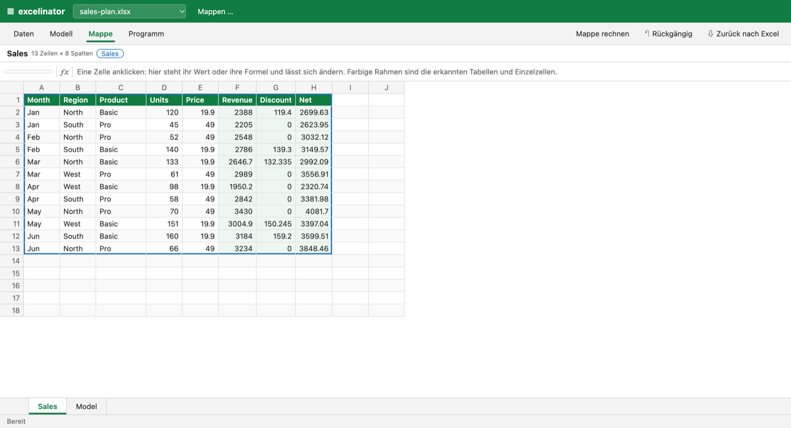
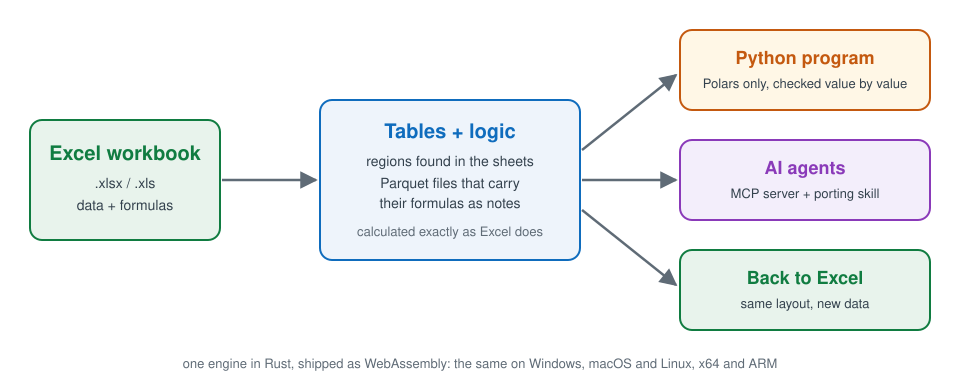
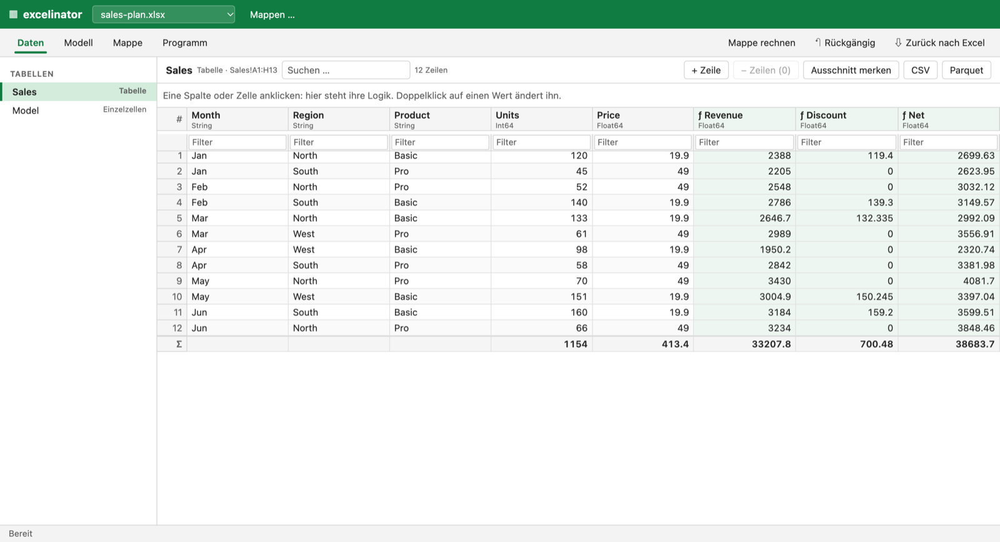
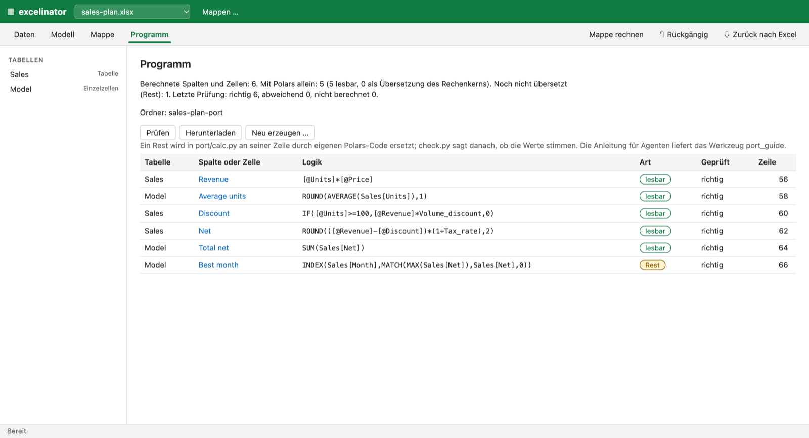

<div align="center">

# excelinator

**Turn Excel workbooks into tested Python programs, and keep the way back to Excel.**

[](https://github.com/klausries/excelinator/actions/workflows/ci.yml)
[](#license)




</div>

Spreadsheets run businesses. Their logic hides in cells, their data is copied by hand, and
nobody dares to touch them. excelinator reads a workbook the way Excel does, finds its
tables and its model, calculates every formula exactly as Excel would, and turns all of it
into **data plus logic**: Parquet files that carry their formulas, a Python program on
[Polars](https://pola.rs) that reproduces the workbook value by value, and a way back into
the original workbook, in its original layout, with new data.

It is built for **AI agents** as much as for people: an MCP server gives Claude, Copilot or
any other agent the tools, and a porting guide tells it how to finish the job.

<p align="center"></p>

## What it does

- **Understands a workbook.** Finds the tables, single input and result cells and grids
  in each sheet, the logic of every calculated column (`[@Units]*[@Price]`), and the rows
  that deviate from their column.
- **Calculates as Excel does.** A formula engine in Rust covers the functions business
  workbooks use (lookups, conditional sums, dates, finance, statistics, text); its results
  are compared with the values Excel stored in more than a thousand real-world workbooks.
- **Moves it into data.** Each region becomes a Parquet file whose metadata holds its
  logic, so a database or a notebook can recalculate it without the workbook.
- **Ports it to Python.** `export_port` writes a project on Polars, `check.py` proves it
  against the workbook. What it cannot translate yet is named, never hidden.
- **Brings it back.** Changed data goes into the workbook as it was built: tables grow
  and shrink, sums below them follow, formats stay.
- **Shows it.** An app in the browser, inside a chat (MCP Apps) and on the desktop, in
  the look of Excel, with levels for data, model, the sheet and the program.

## Quick start

With [uv](https://docs.astral.sh/uv/) and the wheel from the
[releases](https://github.com/klausries/excelinator/releases) (one wheel for every
processor; nothing is compiled on your machine):

```sh
uv tool install xlcells-0.1.0.dev1-py3-none-any.whl   # the MCP server: xlcells-mcp
xlcells-mcp --app ./my-workbooks                       # the app: http://127.0.0.1:8787/
```

```python
import xlcells.openpyxl as xo            # the interface of openpyxl

wb = xo.load_workbook("sales-plan.xlsx")
wb.calculate()                           # every formula, as Excel calculates it
wb.regions["Sales"].to_polars()          # a table found in the sheet, as a DataFrame
store = wb.to_store("sales-plan.store")  # Parquet files that carry their logic
store.to_port("sales-plan-port")         # the workbook as a Python program
```

**Windows, locked down?** Download `excelinator-…-windows-x64.zip` (or `-arm64`), unpack
it anywhere and run `xlcells-mcp.cmd`. Python, Polars and the engine are inside: no
installation, no administrator rights, no compiler.

## A workbook becomes a program

```console
$ cd sales-plan-port && uv run check.py
6 calculated columns and cells: 5 worked out by Polars alone (5 readable, 0 the engine's translation), 1 not ported yet.
checked: 5 right, 0 different, 1 not worked out (values of expected/), 0 not compared (their value depends on the moment or on chance).
  kept          Model[Best month]  =INDEX(Sales[Month],MATCH(MAX(Sales[Net]),Sales[Net],0))  (rest; port/calc.py:66)
```

Every calculated column is plain Polars under a comment with the workbook's logic:

```python
# Sales[Net]  =ROUND(([@Revenue]-[@Discount])*(1+Tax_rate),2)
sales = sales.with_columns(((pl.col("Revenue") - pl.col("Discount")) * (1 + tax_rate))
                           .round_sig_figs(15).round(2, mode="half_away_from_zero").alias("Net"))
```

The project runs with Polars alone from the first minute. What is left (`rest`) is the
agent's work: in a test, **Claude Code finished the port of a real Enron workbook on its
own, 32 of 32 calculated columns and cells, 0 different values, also on changed data**
(4 minutes, about 1.50 USD).

<table>
<tr>
<td></td>
<td></td>
</tr>
<tr>
<td align="center">Data: filter, sort, edit; the workbook recalculates</td>
<td align="center">Program: how far the port is, column by column</td>
</tr>
</table>

## For AI agents

| Agent | How |
|---|---|
| Claude Desktop | add `xlcells-mcp` as a local MCP server (`"command": "xlcells-mcp"`); on Windows the unpacked folder's `python\python.exe -m xlcells.mcp` |
| Claude Code | `claude mcp add excelinator -- xlcells-mcp`, and the skill [`skills/excel-port`](skills/excel-port) |
| Copilot Studio, ChatGPT | `xlcells-mcp --http … --token …` behind HTTPS; see [docs/copilot-agent.md](docs/copilot-agent.md) |

The server offers 22 tools (23 with a workspace: open, describe, read and change regions, run, export, port …),
the prompt `port_workbook`, and the app as an [MCP App](https://modelcontextprotocol.io)
for chats that show apps.

## How it is built

- **Rust** for everything that reads, writes and calculates (`crates/`): the reader and
  writer of xlsx and xls, the formula engine with its own expression form, regions,
  stores, the port, the MCP server.
- **WebAssembly** to ship it: one module for every processor, run by
  [wasmtime](https://wasmtime.dev) from Python; the engine's plans run on the Polars of
  your environment.
- **Python** (`xlcells`) with the interface of openpyxl, so existing scripts keep working.
- **Dart** for the app: one core, drawn by [Jaspr](https://jaspr.site) in the browser and
  in chats, and by [Flutter](https://flutter.dev) on the desktop.

## Status

Pre-alpha. The interfaces will change. Checked on macOS (Apple Silicon); Windows, Linux
and ARM are checked by the release workflow. Not yet tried: Microsoft Copilot, and Claude
Desktop showing the app inside the chat. What is checked and what is not:
[docs/RELEASE.md](docs/RELEASE.md).

## Documentation

The handbook and the technical notes are in German:

- [docs/HANDBUCH.md](docs/HANDBUCH.md): the way from a workbook to data and back, every
  call of Python, the MCP server and the app, the port, the limits.
- [docs/TECHNIK.md](docs/TECHNIK.md): the reader and writer, the engine, measurements on
  real workbooks.
- [skills/excel-port](skills/excel-port): the porting guide for agents (English).

## Contributing

Issues and pull requests are welcome: see [CONTRIBUTING.md](CONTRIBUTING.md).

## License

Dual-licensed under [MIT](LICENSE-MIT) or [Apache-2.0](LICENSE-APACHE), at your option,
as is usual in the Rust ecosystem. © 2026 Klaus Ries.
